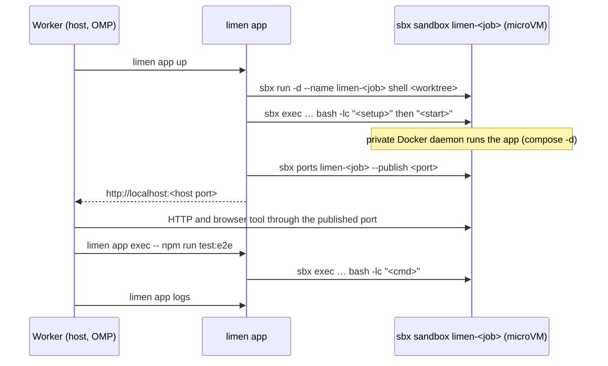

# Design: app sandbox

Copied from the owner's design (harness design §3, 2026-10-11) so the worker has it in the worktree. The plan's corrections C9 and C10 and the checked CLI syntax in sbx-cli.md win where they differ.


Scope: run the project's app under development in a Docker Sandbox, so that an agent can call it, read its logs, run commands in its environment, and take screenshots with its browser tool. The agents (coordinator, workers, reviewers) stay on the host. Only the app runs in the sandbox.

Source: https://docs.docker.com/ai/sandboxes/ (usage, architecture, development workflow, environment files, `shell` agent).

### 3.1 How an agent runs the app



- The `shell` agent is the agent-less sandbox type. `sbx run -d` keeps it running with no session attached.
- Direct workspace mode mounts the job's worktree at the same absolute path. File changes by the worker on the host appear in the sandbox at once, so a dev server with file watching reloads by itself.
- Each sandbox has its own Docker daemon and network. Two jobs can run the same compose file with the same ports. No port override file is needed. `sbx ports --publish <port>` with no host port lets the OS choose a free host port. `sbx ports <name>` reports it.
- `sbx exec` runs commands in the foreground only. Detached `exec` is not supported. So `start` must return after it starts the app: `docker compose up -d` does this, because the sandbox's daemon owns the containers.
- Services must listen on `0.0.0.0` inside the sandbox. A service bound to `127.0.0.1` is not reachable through a published port.

Why `sbx`, not plain Docker on the host:

- Code that the agent wrote, and the install scripts of its dependencies, run behind a hypervisor boundary. They cannot read `~/.ssh`, the `gh` token, or `~/.config/limen/`.
- Outbound traffic goes through a host proxy with network policies. Credentials can be injected by that proxy (`sbx secret`) and never enter the VM.

Costs:

- One VM per job.
- Sandboxes do not share images or layers, so the first build in each job is cold. Disk use grows until `sbx rm`.
- KVM, membership in the `kvm` group, and `sbx login` with a Docker account.

### 3.2 Config: `.agents/limen/sandbox.json`

```json
{
  "enabled": true,
  "setup": ["npm ci"],
  "start": "docker compose up -d --build",
  "stop": "docker compose down",
  "ports": { "web": 3000, "api": 8080 },
  "ready": { "url": "http://localhost:{port.web}/health", "timeout": 180 },
  "logs": "docker compose logs --no-color --tail 300",
  "env": { "NODE_ENV": "development" },
  "resources": { "cpus": 4, "memory": "8g" }
}
```

- `enabled: false`, or no file: every `limen app` command refuses with "sandbox disabled for this project". Nothing is injected.
- `sbx` missing or not logged in: `limen app up` refuses and prints the install steps. There is no fallback to host Docker, because a fallback would silently remove the isolation.
- `setup` runs in order. It stops at the first failure.
- `ports` maps a name to a port inside the sandbox. `{port.<name>}` in `ready.url` becomes the published host port.
- `env` becomes `-e` flags on the sandbox. Secrets are not in this file. Use `sbx secret set` on the host.
- The worktree is mounted read-write. `npm ci` in the sandbox writes `node_modules` into the worktree. Host and sandbox are both Linux x64 on this machine, so the binaries also work on the host. On a macOS host they would not.
- Git inside the sandbox does not work. The worktree's `.git` file points into the main repo's `.git/worktrees/<id>`, which is not mounted. The app must not need Git to run. If a build calls `git describe`, mount the main repo's `.git` read-only as an extra workspace (check 8).

### 3.3 Commands

| Command | Action |
|---|---|
| `limen app up [job]` | `sbx run -d --name limen-<job> <resources> <env> shell <worktree>`, then `sbx exec limen-<job> bash -lc` with each `setup` command and `start`. Then `sbx ports limen-<job> --publish <port>` for each port, read the host ports, write the job record, and poll `ready` from the host. Without a job, it uses the current checkout and the name `limen-<repo>-main`. |
| `limen app exec [job] -- <cmd>` | `sbx exec limen-<job> bash -lc "<cmd>"`, for tests, migrations, and seed scripts in the app environment |
| `limen app logs [job]` | `sbx exec limen-<job> bash -lc "<logs>"` |
| `limen app url [job] [name]` | Print one URL from the job record |
| `limen app status [job]` | The `sbx ls` row, the published ports, and one `ready` probe |
| `limen app down [job]` | `bash -lc "<stop>"` in the sandbox, then `sbx rm --force limen-<job>` |

### 3.4 Job record

```
.limen/jobs/<id>/app/
  sandbox      limen-<id>
  ports.json   {"web": 51234, "api": 51235}
  url          http://localhost:51234
  up.log       output of setup and start
```

Logs are read on demand with `limen app logs`. No log follower process runs.

### 3.5 Lifecycle and context

- The coordinator starts the app for a job, or the worker runs `limen app up` when its task needs the app.
- When `app/url` exists, the communication hook injects one line for that job: `App: http://localhost:51234 · run commands with limen app exec · logs with limen app logs`.
- `limen stop`, `limen land`, and `limen prune` run `app down` for the job. `limen prune` also removes `limen-*` sandboxes that have no job record. A sandbox never outlives its job record.

### 3.6 This machine (checked 2026-10-11)

| Requirement | State |
|---|---|
| Ubuntu 24.04 or later | Ubuntu 24.04.4 under WSL2 |
| `/dev/kvm` | present |
| User in the `kvm` group | no: `sudo usermod -aG kvm jakub` |
| `sbx` installed | no: Docker apt repo, then `sudo apt install docker-sbx` |
| `sbx login` | not done |

Docker's docs list Ubuntu with KVM. They do not name WSL2. Nested KVM is present, so local sandboxes may work [INFERENCE]. Check 3 in §5 decides it.

